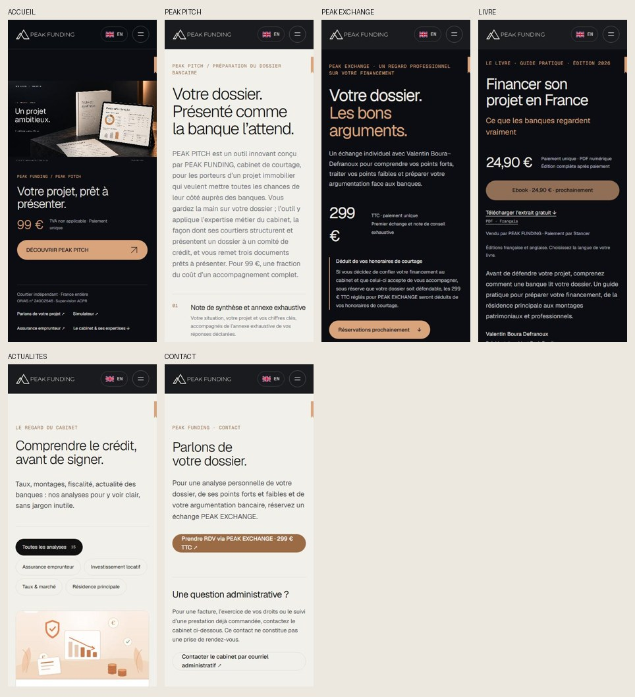
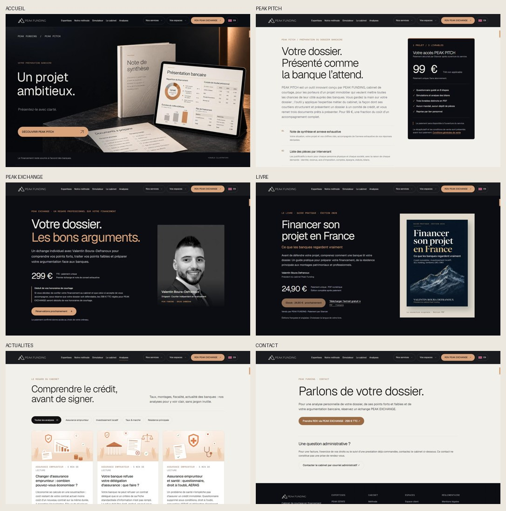

# Audit UX Design et parcours utilisateur — PEAK FUNDING

**14 novembre 2026 · Clone non publié · Référence `74e5084`**

## Synthèse

La direction graphique est cohérente. L’ivoire, le cuivre, le fond sombre et Geist unifient les offres. La vidéo PEAK PITCH, le portrait de Valentin et la couverture du livre donnent à chaque service un repère visuel propre. Le menu « Nos services » présente clairement les trois offres et leurs prix sur ordinateur. Les problèmes les plus importants concernent la fiabilité du simulateur, le retour après paiement et la hiérarchie du premier écran sur mobile.

| Priorité | Où intervenir | Résultat attendu |
| --- | --- | --- |
| P0 · Fiabilité | Simulateur | Une valeur invalide ne peut jamais améliorer la capacité affichée. |
| P0 · Accès après paiement | EXCHANGE et livre | Un acheteur retrouve son accès après fermeture, changement de navigateur ou perte de la session, sans repayer. |
| P1 · Décision mobile | Accueil et pages PITCH/EXCHANGE | Offre, prix et action compréhensibles dès le premier écran sur les formats ciblés. |
| P1 · Continuité | Checkout FR/EN, états d’erreur et agenda | Le client sait ce qu’il paie, où il en est et comment terminer la démarche. |
| P1 · Accessibilité | Contrastes, vidéo et commandes | Texte lisible, contrôle du mouvement et intitulés accessibles cohérents. |
| P2 · Finition | Signet, questionnaire, extrait du livre | Une navigation plus sobre et des repères constants. |

P0 identifie un risque d’estimation trompeuse ou de perte d’accès après achat. P1 concerne une friction importante avant lancement. P2 concerne la lisibilité ou l’efficacité. Le classement décrit l’impact attendu, sans données de conversion.

## 1. Design et lisibilité

### Accueil et navigation

- **H1 · P1 · La largeur du film peut repousser le lien sous l’écran.** À 2 560 × 1 080, le bouton « Découvrir PEAK PITCH » commence à y = 1 120 px. À 844 × 390, il commence à 421 px. À 1 440 × 720, son bas arrive à 722 px. Le film s’étend selon le ratio 16:9 à partir de la largeur. Conserver la mise en scène et limiter sa hauteur utile sur les écrans courts ou ultralarges, avec une zone d’action HTML visible. Vérifier aux trois formats et à 320 × 568.
- **H2 · P1 · L’accueil raconte PITCH avant d’orienter vers le cabinet.** Sur téléphone, le premier écran est presque entièrement dédié au produit à 99 €. Le simulateur et les expertises sont accessibles via le menu ou le pied du héros. EXCHANGE perd son CTA dédié sous 640 px et passe par le menu. Donner une place lisible aux entrées « Estimer mon budget » et « RDV PEAK EXCHANGE » autour du film actuel, en gardant un CTA principal. Ajouter un lien de découverte des trois services si la personne arrive sans intention précise.
- **H3 · P1 · Le film commence automatiquement et dure 22 s.** En Chromium, le menu interrompt la lecture, Échap la reprend, la vidéo s’arrête à 22 s et « Découvrir PEAK PITCH » ouvre la page attendue. En mouvement réduit et en mode statique, la vidéo se met en pause après quelques images (jusqu’à 0,14 s observé). Le fond s’assombrit et s’éclaircit au défilement, et les animations d’avis tournent. Mettre en œuvre un vrai contrôle pause/reprise discret, sans réintroduire un bouton « Lire la vidéo » comme écran d’entrée. En mouvement réduit, servir l’affiche dès le départ. Tester aussi au clavier. [WCAG 2.2 — Pause, Stop, Hide](https://www.w3.org/TR/WCAG22/#pause-stop-hide)
- **H4 · P2 · Le signet de lecture est visible mais peu explicite.** L’encoche occupe 7 px sur ordinateur et 4 px sur mobile. Elle peut défiler via la touche Fin sur ordinateur, avec un écart de 40 px observé pendant le test. Sur mobile, elle sert de repère visuel et ne se manipule pas. Le menu mobile reste utilisable en défilant à 320 × 568 et en paysage. Conserver un repère passif discret et privilégier des ancres de section explicites pour un saut volontaire.
- **H5 · P1 · Les libellés accessibles diffèrent des textes visibles.** Axe relève le sélecteur de langue sur les six familles contrôlées, le lien de la vidéo sur plusieurs rendus et des `aria-label` posés sur des `span` d’avis sans rôle adapté. Intégrer « EN » / « FR » dans le nom du lien, limiter le nom du CTA vidéo au libellé visible avec un descriptif séparé, et exposer la note des avis par un texte accessible. Refaire un contrôle voix et lecteur d’écran. [WCAG 2.2 — Label in Name](https://www.w3.org/WAI/WCAG22/Understanding/label-in-name.html)

### Pages d’offre

- **D1 · P1 · PEAK PITCH cache son prix derrière la présentation sur mobile.** À 390 px, le bloc prix commence vers y = 1 366 px. À 320 px, il commence vers 1 716 px. Le prix figure déjà dans le paragraphe d’introduction, mais le visiteur doit lire un long bloc et la présentation des livrables avant de voir le prix mis en avant et l’état de vente. Placer un résumé « 99 € · trois livrables · TVA non applicable », l’action ou l’état d’ouverture, et une présentation courte juste après le titre. Garder le descriptif complet en dessous. Le bloc latéral actuel est efficace sur ordinateur.
- **D2 · P1 · EXCHANGE perd le prix sur une ligne et l’action au-dessus de la ligne de flottaison.** À 390 px, « 299 » et « € » sont sur deux lignes, le bouton va de y = 788 à 836 px. À 320 × 740, il commence à 877 px. Garder « 299 € TTC » d’un seul tenant, réduire les marges et déplacer le bloc détaillé de déduction après l’action, avec une mention courte près du tarif. Sur 390 × 844, afficher le prix et l’action sans défilement.
- **D3 · P1 · Les textes cuivre et gris sont parfois trop peu contrastés.** Cuivre `#9a6b45` sur ivoire `#f2f0eb` à 4,04:1, sur le fond beige EXCHANGE à 3,50:1, introduction PITCH à 4,34:1. Les trois valeurs sont sous 4,5:1 pour les tailles relevées. Créer un cuivre texte plus foncé pour les fonds clairs, garder le cuivre clair pour les actions sur fond sombre, puis vérifier les couleurs réellement composées par l’animation. [WCAG 2.2 — Contrast Minimum](https://www.w3.org/TR/WCAG22/#contrast-minimum)
- **D4 · P2 · Le livre a une bonne entrée par l’extrait, mais le choix de langue arrive tard.** À 390 px, l’extrait est accessible vers y = 495 px, le bloc « Votre édition » commence vers 1 271 px. Déplacer le choix de l’édition près du prix et de l’extrait. Préserver la couverture, la mention de l’édition et le lien discret vers les conditions de vente. Tant que la vente est fermée, donner la couleur d’action principale à l’extrait.
- **D5 · P2 · La continuité typographique s’arrête à certaines pages de paiement et de retour.** La confirmation EXCHANGE utilise Arial et monospace générique, alors que les pages d’offre emploient Geist et Geist Mono. Reprendre les mêmes jetons visuels sur les écrans internes de commande et de retour. Les pages de connexion Actelo relèvent de leur propre charte.

## 2. Parcours utilisateur

| Intention | Chemin vérifié | Résultat et friction |
| --- | --- | --- |
| Comprendre l’offre | Accueil → Nos services → produit | Les trois services sont accessibles, les noms et prix sont lisibles sur ordinateur. Entrée mobile via le hamburger. |
| Préparer un dossier | Vidéo → PITCH → commande → questionnaire → 3 PDF | Lien vidéo testé. Offre fermée dans le clone. En serveur isolé, génération simulée et trois PDF vérifiés. L’écran de commande directe a un état fermé ambigu. |
| Faire analyser un dossier | Navigation/Contact → EXCHANGE → commande → confirmation → Proton | CTA mène à l’offre. En retour simulé, l’agenda apparaît après paiement confirmé, avec le numéro de téléphone affiché dans la confirmation PEAK EXCHANGE. Transfert dans l’événement Proton à tester. |
| Lire avant d’acheter | Nos services → Livre → extrait / autre édition | Les deux PDF gratuits téléchargent correctement. L’édition est lisible après téléchargement. L’achat est fermé. |
| Retrouver un achat | Retour de paiement → accès ou récupération | Lien de reprise PITCH testé dans un contexte navigateur vierge. Livre et EXCHANGE reposent sur la session de commande dans les écrans revus. |
| Simuler | Menu → résultat → hypothèses et détails | Le résumé se met à jour, « Voir le détail » amène au résultat sous le header. Une charge négative fausse le résultat. |
| Suivre un dossier de courtage | Vos espaces → Actelo | Pages d’entrée client et mandataire répondent. Authentification et expérience interne hors périmètre. |
| Poser une question administrative | Contact → bloc administratif | Rubrique dédiée. Le navigateur reconstitue une adresse et ouvre le logiciel de messagerie via `mailto:`. La destination est récupérable. |

### Avant paiement

- **P1 · Simulateur, défaut P0.** À 390 px, partir du scénario locatif, modifier le revenu à 7 000 €, puis saisir −3 000 € dans « Charge(s) de prêt actuelle(s) ». Le champ est invalide au sens du navigateur, mais le budget passe de 525 000 € à 1 095 000 €. Le calcul React réagit avant soumission et utilise la valeur saisie malgré `min=0`. Garder le dernier résultat valide ou suspendre le résultat avec une erreur à côté du champ. Vérifier également revenus et apport négatifs, valeurs vides, décimales et collage. Tester les mêmes cas dans le module PITCH avant de conclure qu’ils y sont corrigés.
- **P2 · Commande PITCH fermée.** Dans `/paiement.html?annule=1`, avec une configuration fermée, le message indique « Aucun débit n’est possible », le bouton Payer reste activé et les liens de conditions perdent leur destination. Le site vitrine bloque correctement l’accès commercial. Aligner le comportement de l’URL directe avec l’état serveur et garder les conditions consultables.
- **P3 · Passage de l’anglais au français.** Le changement de langue conserve la page d’offre. Les liens PITCH et EXCHANGE prévus à l’ouverture pointent respectivement vers `paiement.html` et `exchange-paiement.html`, dont les écrans actuels sont en français. L’extrait du livre et son retour de paiement ont une logique d’édition FR/EN. Pour PITCH et EXCHANGE, transporter la langue dans le checkout et les retours, ou annoncer clairement la langue de la prestation lorsque le choix découle d’une règle métier. Vérifier aussi les erreurs, reçus et messages transactionnels.
- **P4 · Contact et confidentialité.** L’adresse administrative est encodée dans le HTML, décodable et transmise au logiciel de messagerie au clic. Elle est donc récupérable, même si le lien est discret. Si l’exigence est de rendre l’adresse inaccessible depuis le site, prévoir un canal administratif côté serveur, distinct de la prise de RDV, qui n’expose jamais le destinataire dans le navigateur.

### Paiement confirmé, annulation et reprise

- **R1 · Accès après paiement, défaut P0 pour EXCHANGE et livre.** Dans des sessions vierges, les retours simulés sans commande affichent un message et le seul bouton « Vérifier à nouveau ». Les écrans n’offrent aucun moyen observable de retrouver la commande, puisque l’accès passe par le cookie. Ajouter une récupération vérifiée par référence et email, ou un lien personnel envoyé avec la confirmation de commande. Après paiement, la référence, la prochaine action et l’aide doivent rester accessibles. Ne jamais demander un nouveau débit pour retrouver un achat payé. Les confirmations simulées ouvrent bien le bouton Proton ou le bouton de téléchargement quand le serveur confirme l’achat. [Référence de parcours Fresha](https://refero.design/flows/2379)
- **R2 · PITCH, attente et erreur.** Le retour initial utilise le titre « Nous confirmons votre paiement » même pour une session absente. Une réponse 404 reste dans l’état d’attente, alors qu’une réponse 410 remboursée affiche le motif. Prévoir des écrans explicites pour attente, paiement refusé, annulation, session introuvable et remboursement, avec une action adaptée à chacun. Pour l’attente, proposer de quitter et reprendre sans paiement supplémentaire.
- **R3 · EXCHANGE, transfert entre deux services.** Le retour affiche la référence et le téléphone avant d’ouvrir un nouvel onglet Proton. Les tests ont établi l’affichage du lien et la présence du téléphone dans la commande. L’inscription du téléphone et des informations pertinentes dans l’événement Proton reste à tester. Ajouter un message « Choisissez votre créneau pour confirmer le rendez-vous » et vérifier le scénario sans créneau, la fermeture de l’onglet, l’annulation et le changement de créneau.
- **R4 · PITCH, reprise et restitution.** Le lien de reprise ouvre le dossier fictif dans un navigateur vierge et le jeton est retiré de la barre d’adresse. Le serveur a produit trois PDF distincts, téléchargés au format attendu via les routes authentifiées. La suite automatisée vérifie aussi le retéléchargement après redémarrage, sans nouvel appel Claude. Pour un client réel, distinguer « Copié », « Enregistré » et « À conserver », donner une aide en cas de lien perdu, et conserver l’aperçu et les points de vigilance avant la confirmation de génération. Après rechargement de l’écran final, les trois boutons ont téléchargé les PDF attendus. Le bouton de génération affichait « Génération incluse utilisée ».
- **R5 · Progression PITCH.** L’exemple s’ouvre directement sur Projet, à l’étape 6 sur 10, avec « 100 % des réponses requises ». Cette valeur mesure la complétude, tandis que l’étape indique la position. Pour faciliter le premier essai, annoncer l’étape ouverte et afficher séparément la progression de navigation et les informations restant à renseigner. Dans le service client, mettre à portée la reprise et l’aide dès les premières étapes.

## 3. Plan de correction et critères de recette

| Lot | Corrections | Test de sortie |
| --- | --- | --- |
| 1 · Fiabilité | Bloquer l’effet des entrées invalides sur la simulation. Concevoir une récupération d’achat EXCHANGE/livre. | La charge négative ne change plus le résultat. Après effacement du cookie, récupération avec preuve de l’achat et sans second débit. |
| 2 · Décision mobile | Replacer prix et actions. Corriger le retour à la ligne du tarif. Ajuster le film aux écrans courts. | Prix et action lisibles à 320–390 px. CTA vidéo visible à 844 × 390 et 2 560 × 1 080. Accès à l’extrait en une action depuis le livre. |
| 3 · Continuité | Unifier les états de vente, erreurs, langue et présentation du checkout. Vérifier le téléphone dans Proton. | Scénarios confirmé, en attente, annulé, refusé, expiré et remboursement lisibles. FR/EN cohérent. Concordance entre l’achat, le créneau et le téléphone en test. |
| 4 · Accessibilité | Revoir les couleurs de texte, le nom des contrôles, le contrôle du film, le signet et le menu clavier. | Axe sans les écarts relevés, contrôles vérifiés au clavier et en mouvement réduit. Les transitions de fond et les avis animés fonctionnent en mode standard. |

## 4. Couverture, preuves et limites

- **Vitrine** · 12 routes types en FR/EN, six largeurs de 320 à 1 920 px sous Chromium, soit 144 rendus HTTP 200. Six familles à 390 et 1 440 px en FR/EN sous Firefox et WebKit, soit 48 rendus supplémentaires. Écrans courts et 2 560 px en contrôle ciblé. Les rendus sont émulés. L’écart de largeur initial sur Analyses à 1 024 px est resté isolé. Les vérifications répétées sur le clone et la version compilée ont toutes mesuré la largeur attendue.
- **Accessibilité** · Axe exécuté sur 24 combinaisons de pages, langues et largeurs. Contrôles manuels du clavier, des menus, du contraste remonté et du mouvement. Périmètre de diagnostic, sans déclaration de conformité ni essai complet avec un lecteur d’écran.
- **Interactions vérifiées** · Ouverture/fermeture par Échap, focus rendu au menu, menus exclusifs, changement de langue sur EXCHANGE, film terminé et lien fonctionnel, transitions de fond, animation des avis, FAQ, simulateur et deux téléchargements d’extraits gratuits.
- **Parcours transactionnels** · Retours simulés dans le navigateur, scénarios d’API avec données fictives et production locale des trois PDF PITCH avec transport Claude simulé. Versions serveur auditées `144edfa` pour PITCH/EXCHANGE et `852521c` pour le livre. Aucun paiement, message ni rendez-vous réel. Les interfaces Stancer et Proton ainsi que l’accès Actelo authentifié demandent une recette d’intégration dédiée. Suite vitrine, 70 succès et un test historique omis. Suite PITCH/EXCHANGE, 122 succès. Branche livre, 125 succès en série. Un test de génération lié à la rétractation a échoué lors du premier passage concurrent, puis a réussi en isolé et en série.
- **Références de design** · Le site PEAK FUNDING et sa charte Altitude servent de référence principale. Titan illustre le rôle du portrait pour humaniser une offre de conseil et Fresha la visibilité du récapitulatif dans un parcours de réservation. [Titan](https://titan.com/) · [Fresha, parcours de réservation](https://refero.design/flows/2379)
